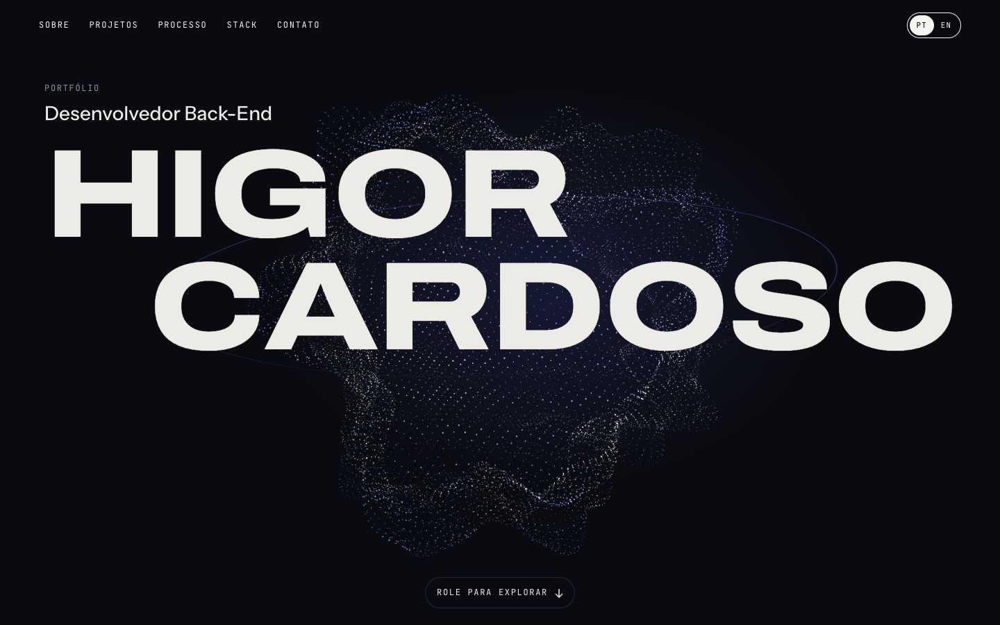
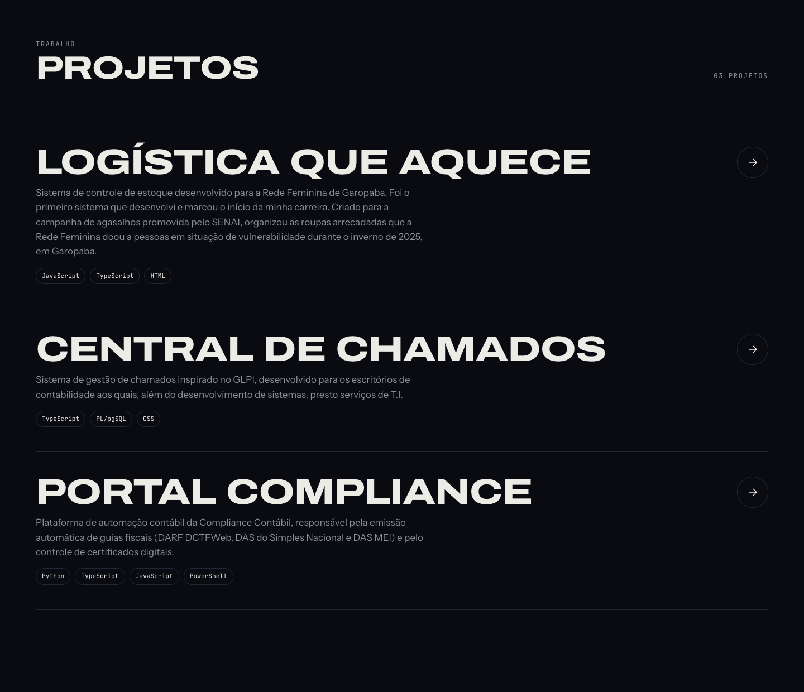
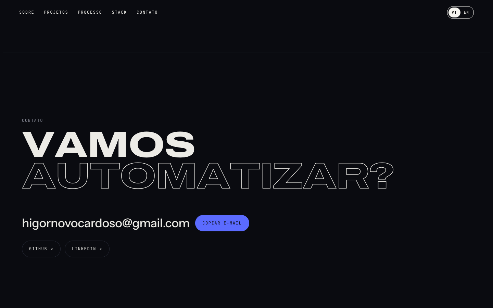
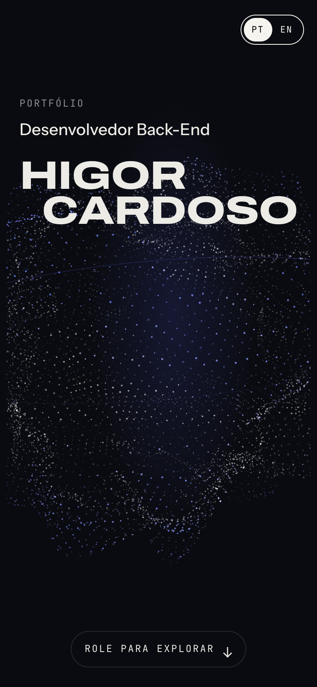
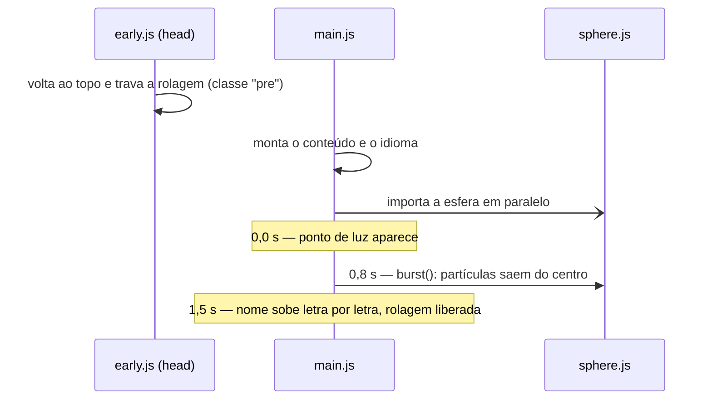
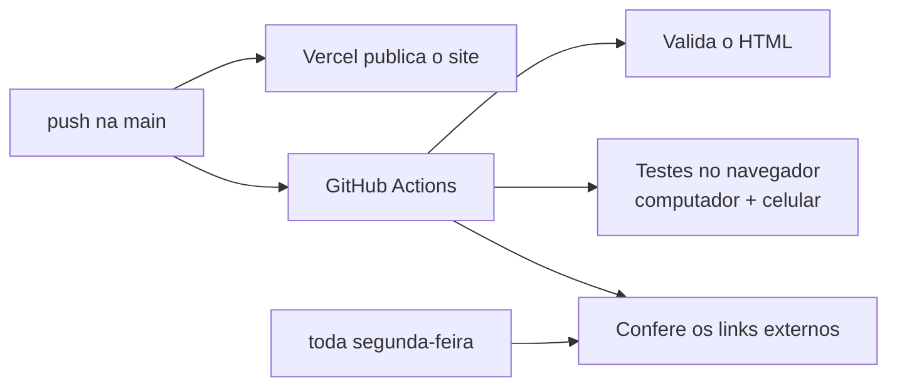

<div align="center">



# Higor Cardoso · Portfólio

**Desenvolvedor Back-End** · Garopaba, SC

Portfólio pessoal com uma esfera 3D de partículas feita com shaders próprios, animações ligadas à rolagem e versão em português e inglês. Tudo em HTML, CSS e JavaScript puros, sem framework e sem etapa de build.

[](https://higornovocardoso.com)
[](https://github.com/higornovocardoso/Portfolio/actions/workflows/verificar-site.yml)
[](LICENSE)

[**Ver o site**](https://higornovocardoso.com) · [LinkedIn](https://www.linkedin.com/in/higornovocardoso) · [GitHub](https://github.com/higornovocardoso)

</div>

---

## Sumário

- [Destaques](#destaques)
- [Capturas de tela](#capturas-de-tela)
- [Tecnologias](#tecnologias)
- [Estrutura do projeto](#estrutura-do-projeto)
- [Como funciona](#como-funciona)
- [Rodando localmente](#rodando-localmente)
- [Editando o conteúdo](#editando-o-conteúdo)
- [Qualidade e automação](#qualidade-e-automação)
- [Acessibilidade e desempenho](#acessibilidade-e-desempenho)
- [Licença](#licença)

## Destaques

- **Esfera 3D de partículas.** São cerca de 15 mil pontos deformados por ruído simplex na GPU. A esfera se inclina na direção do mouse, estufa no lado voltado para o cursor e fica mais agitada quanto mais rápido o mouse se move.
- **Abertura "big bang".** Um ponto de luz surge no centro e explode em partículas que giram até formar a esfera. Depois o nome sobe letra por letra.
- **Animações de rolagem nos dois sentidos.** Títulos entram letra por letra, textos palavra por palavra e listas em sequência. Ao voltar a página, tudo sai na ordem inversa.
- **Bilíngue.** Português e inglês com troca instantânea. A escolha fica salva no navegador.
- **Detalhes de interação.** Cursor personalizado, botões "magnéticos", barra de progresso de leitura e menu que marca a seção atual. Cada projeto inteiro funciona como link.
- **Sem build.** O que está no repositório é exatamente o que vai para o ar.
- **Testado automaticamente.** A cada alteração, o site é validado e testado num navegador real, no computador e no celular.

## Capturas de tela

| Projetos | Contato |
| --- | --- |
|  |  |

<p align="center">
  
</p>

## Tecnologias

| Camada | Escolha | Por quê |
| --- | --- | --- |
| Estrutura e estilo | HTML e CSS puros, com variáveis CSS | Nada a compilar; os tokens de design ficam num arquivo só |
| Comportamento | JavaScript em módulos ES nativos | Cada parte do site num arquivo, carregado direto pelo navegador |
| 3D | [Three.js](https://threejs.org) r128 + shaders GLSL próprios | O desenho das partículas é feito inteiro na GPU |
| Tipografia | Archivo, Instrument Sans e JetBrains Mono (Google Fonts) | Título expandido e marcante, texto legível, detalhes em fonte mono |
| Hospedagem | [Vercel](https://vercel.com) | Publica sozinha a cada push na `main` |
| Testes | [Playwright](https://playwright.dev), [html-validate](https://html-validate.org) e [lychee](https://lychee.cli.rs) | Navegador real, HTML válido e links funcionando |
| CI | GitHub Actions | Roda tudo a cada push, em pull requests e toda semana |

## Estrutura do projeto

```text
.
├── index.html                  # só a estrutura da página
├── 404.html                    # página para endereços que não existem
├── assets/
│   ├── css/
│   │   ├── tokens.css          # cores, fontes e escalas (o design inteiro em um lugar)
│   │   ├── base.css            # reset e utilitários (.wrap, .display, .label, .sr-only)
│   │   ├── layout.css          # barra do topo, tela inicial e faixa de ferramentas
│   │   ├── sections.css        # sobre, projetos, processo, stack e contato
│   │   ├── motion.css          # abertura, animações de rolagem, cursor e modo sem movimento
│   │   └── 404.css
│   ├── js/
│   │   ├── early.js            # roda antes de pintar a tela: volta ao topo e prepara a abertura
│   │   ├── main.js             # ponto de entrada e linha do tempo da abertura
│   │   ├── content.js          # ✏️ conteúdo: projetos, stack, e-mail e redes
│   │   ├── i18n.js             # ✏️ textos em português e inglês
│   │   ├── render.js           # monta projetos, stack e contatos; aplica o idioma
│   │   ├── text-split.js       # divide títulos em letras e textos em palavras
│   │   ├── reveal.js           # aparece e some conforme a rolagem
│   │   ├── scroll.js           # barra de progresso, parallax e menu ativo
│   │   ├── marquee.js          # faixa de ferramentas
│   │   ├── cursor.js           # cursor personalizado e botões magnéticos
│   │   ├── contact.js          # botão "Copiar e-mail"
│   │   ├── utils.js
│   │   └── sphere/
│   │       ├── sphere.js       # cena Three.js, mouse, rolagem e explosão inicial
│   │       └── shaders.js      # GLSL: ruído simplex, deformação e cor das partículas
│   └── img/                    # favicon e imagem de compartilhamento
├── docs/                       # capturas usadas neste README
├── tests/site.spec.js          # testes no navegador (Playwright)
├── .github/workflows/          # verificação automática (GitHub Actions)
├── vercel.json                 # cabeçalhos de segurança e URLs limpas
├── robots.txt · sitemap.xml    # SEO
└── package.json                # só ferramentas de teste; o site não depende dele
```

## Como funciona

### Linha do tempo da abertura



Se a biblioteca 3D demorar a carregar, a explosão acontece assim que ela chega. Se não carregar de jeito nenhum (sem WebGL, CDN fora do ar), o resto do site funciona normalmente. Um temporizador em `early.js` libera a página em até 4 segundos aconteça o que acontecer.

### A esfera

- **Distribuição.** Os pontos são espalhados por uma espiral de ângulo áureo (esfera de Fibonacci), o que garante densidade uniforme.
- **Deformação.** O vertex shader soma duas camadas de ruído simplex 3D que mudam com o tempo. Também adiciona uma "bolha" na direção do cursor e um tremor proporcional à energia do mouse.
- **Explosão inicial.** Cada partícula tem um atraso aleatório e sai do centro com rotação, passa um pouco do lugar e volta (`uIntro` vai de 0 a 1 em 2 s).
- **Economia.** A renderização para quando a tela inicial sai de vista.

### Animações de rolagem

Um único `IntersectionObserver` cuida de tudo. O elemento aparece quando o topo dele passa de 88% da altura da tela. Ao rolar para cima, recebe de novo a classe `off` e some. Cada letra, palavra ou item recebe sua posição em `--i` e o total em `--n`. Assim o CSS calcula o atraso de cada um, `calc(var(--i) * 45ms)` para entrar e `calc((var(--n) - var(--i)) * 22ms)` para sair ao contrário. Nada é animado por JavaScript quadro a quadro, só `transform` e `opacity` via CSS.

## Rodando localmente

Pré-requisito: [Node.js](https://nodejs.org) 18 ou mais novo, usado só para o servidor local e os testes.

```bash
git clone https://github.com/higornovocardoso/Portfolio.git
cd Portfolio
npm install
npm run servir          # abre em http://127.0.0.1:4173
```

Qualquer servidor estático funciona (por exemplo `python3 -m http.server`). Abrir o `index.html` direto pelo explorador de arquivos não funciona, porque módulos JavaScript exigem `http://`.

## Editando o conteúdo

| Quero mudar… | Arquivo |
| --- | --- |
| Um projeto (título, descrição, link, linguagens) | `assets/js/content.js`, em `projects` |
| As ferramentas da Stack (a faixa da tela inicial acompanha) | `assets/js/content.js`, em `stack` |
| E-mail, GitHub, LinkedIn | `assets/js/content.js`, em `profile` |
| Textos de títulos, botões e seções | `assets/js/i18n.js` (`pt` e `en`) |
| Cores e fontes | `assets/css/tokens.css` |

Um projeto com `url: ""` aparece sem link. Ao enviar a alteração para a `main`, o site é publicado em poucos segundos.

## Qualidade e automação



Os testes (`tests/site.spec.js`) abrem o site num Chromium de verdade, nos tamanhos de computador e de celular, e conferem que:

- a página carrega sem erros no console e sem nenhum arquivo faltando;
- o nome, a função e os três projetos aparecem com os links certos;
- a esfera 3D é desenhada;
- o contato aparece ao rolar até o fim;
- a troca para inglês e de volta funciona;
- nada vaza para os lados da tela;
- recarregar no fim da página volta ao topo;
- a página 404 leva de volta ao início.

Para rodar tudo na sua máquina:

```bash
npx playwright install chromium
npm run verificar       # valida o HTML e roda os testes
```

## Acessibilidade e desempenho

- **Menos movimento:** com "reduzir movimento" ativado no sistema, a página aparece completa e parada.
- **Leitores de tela:** títulos animados letra por letra têm uma cópia invisível com o texto inteiro, e as letras ficam ocultas para leitores de tela.
- **Teclado:** foco visível em tudo que é clicável, e os projetos são links de verdade.
- **Robustez:** sem JavaScript de animação quadro a quadro fora da esfera e da faixa, e as duas param quando saem da tela.
- **Segurança:** cabeçalhos configurados em `vercel.json` (`nosniff`, `X-Frame-Options`, `Referrer-Policy`, `Permissions-Policy`).

## Licença

O código está sob a licença [MIT](LICENSE). Pode estudar, copiar e adaptar. Os textos, o nome e as imagens pessoais não fazem parte da licença: use o projeto como base para o seu próprio portfólio, com o seu conteúdo.

---

<div align="center">
Feito por <a href="https://www.linkedin.com/in/higornovocardoso">Higor Cardoso</a> · Garopaba, SC
</div>
